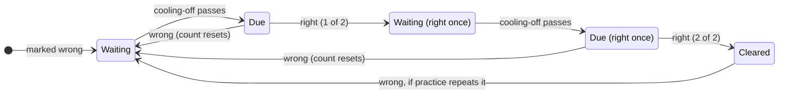

# Idea 05: Challenges — replay your mistakes

## Summary

Add a **Review** mode that brings back problems you marked wrong, after a
cooling-off period you choose (now, 1, 3 or 7 days), so you can find out
whether you can solve them now. A mistake is cleared by **two right answers in
a row**, each after its own wait, and the Review tab carries a badge with how
many are due.

Today a wrong problem is only seen again by accident: practice prefers unseen
problems and repeats one only after a whole subject is exhausted. The worked
solution you read after a mistake is never tested.

Goals:

- Every wrong answer becomes an open mistake you can replay, per dataset,
  across all three datasets (UGPhysics, Hendrycks MATH, data science).
- Replays wait a cooling-off period you pick in the UI, so they test
  understanding rather than memory of the solution you just read.
- Two right answers, on separate occasions, clear a mistake: one could be
  luck or a remembered answer.
- You can see how many mistakes are due at a glance (nav badge), and how many
  are due, waiting and cleared per dataset.
- Replays never move your level or the graded draw's ability estimate: both
  keep measuring fresh problems only.

Non-goals: full spaced repetition (SM-2, Leitner boxes), typed answer
checking, and mixing mistakes into the practice draw. This covers the "missed
this" list listed under the data-science deck's quiz features in
[requirements](requirements.md); the timer and keyboard shortcuts stay
separate.

## Current state

Everything the queue needs is already recorded: every self-marked answer is a
row in `challenges_attempts` with its `correct` flag and timestamp. What is
missing is a way to tell a replay from a practice answer, a second "current
problem" slot so a replay survives a reload, and somewhere to keep the
cooling-off choice.

| Piece | Today | Role in replay |
| --- | --- | --- |
| `challenges_attempts` | One row per mark: `user_id`, `problem_id`, `correct`, `level_at`, `created_at` | Source of truth for mistakes; gains an `is_review` flag |
| `challenges_progress` | Staircase per (user, dataset, subject) | Untouched by replays |
| `ops::draw_graded` | Top-level draw by the grader's ranking, with an ability replayed from your top-level answers | Ability ignores replays |
| `challenges_current` | One problem in progress per (user, dataset) | Model for a separate review slot |
| `challenges_problems.retired_at` | Retired problems are never drawn | Retired problems never come up for review either |
| `ops::mark` / `record_attempt` | Records, moves the staircase, draws the next problem | Split so a replay records without moving the staircase |
| `pages::problem_fragment` | Problem, reveal, right/wrong and skip forms against `/practice/{key}`; prose answers and per-item sources for the deck | Reused with a mode that points the forms at `/review/{key}` |
| `ops::dataset_stats` | Accuracy per subject and level over all attempts | Counts practice attempts only, plus a mistakes line |
| `layout::NavItem` | `href`, `label`, `active`, `right`; no badge | Gains an optional badge |

Two existing behaviours interact with mistakes. The draw's last resort repeats
the problem seen longest ago, so practice can already re-serve a wrong
problem; a right answer there counts toward clearing it. The 10-second
duplicate guard in `record_attempt` applies to replays as well.

## Proposed UX

A third nav tab, **Review**, sits between Practice and Stats, with a badge
showing how many mistakes are due. It works like practice, one problem at a
time per dataset, but draws only from your due mistakes, oldest first.

### Mistake lifecycle

A problem is a mistake from the moment you mark it wrong until you have marked
it right twice since. After every attempt on it, it *waits* for your
cooling-off period, then is *due*. A wrong answer at any point resets the
count. Right answers in practice (when it repeats the problem) count the same
as in review.



The state is derived from the attempt history, never stored: the number of
right answers since the latest wrong one, and when the latest attempt was.

### Cooling-off setting

A segmented control on the Review landing, under the dataset cards:

> Bring mistakes back after: **Now** · **1 day** · **3 days** · **7 days**

It is one setting per user, across datasets, defaulting to 3 days. It is a
plain form of four submit buttons (htmx swaps the landing; a full post
redirects), so it works without JS. Because the wait is applied when the
queue is read, changing it re-sorts existing mistakes at once: switching from
7 days to Now makes every open mistake due.

With **Now**, a mistake you just got wrong in practice is due straight away,
and one you just got right once in review comes back after the others due in
that dataset (the queue is oldest-first, and the review never hands you the
problem you just answered while another is due).

### Nav badge

The Review tab shows the number of due mistakes across your visible datasets
(hidden ones do not count), as a small pill after the label: `Review 4`.
Nothing is shown at 0, and anything over 99 shows `99+`. It updates on every
page load; after marking a replay, the htmx response refreshes it with an
out-of-band swap so it never lags the page.

### Review landing (`/challenges/review`)

One card per visible dataset, reusing the picker's `challenges-dataset` card:

- "4 due · 2 waiting · 11 cleared" and a **Start review** button when
  anything is due.
- With nothing due: "Nothing due. Next mistake comes back on 24 Oct."
- With no mistakes at all: an empty state that points back to Practice.

Then the cooling-off control.

### Review page (`/challenges/review/{key}`)

The same problem card, reveal and right/wrong buttons as practice, with three
differences:

1. A context line under the header: "Marked wrong on 14 Oct" or, after one
   right replay, "Marked wrong on 14 Oct · right once since".
2. No level-change notice; marking shows a one-line result banner instead:
   - right, first time: "Right. Once more on 25 Oct to clear it."
   - right, second time: "Cleared."
   - wrong: "Still open, back on 25 Oct."
3. **Not now** replaces Skip: it moves to the next due mistake without
   recording anything. If it is the only one due, it stays.

When the last due mistake is marked, the page shows "Nothing more due here
for now" with the dataset's counts, when the next one comes back, and links
to Practice and back to the landing.

### Elsewhere

- The picker card gains a quiet "4 mistakes to review" link when anything is
  due.
- The command bar gets a `review_mistakes` action.
- Stats gains a mistakes line per dataset.

### Phone

The review page is the practice page with one extra text line, and the
landing reuses the picker cards. The result banner is one line so the next
problem stays above the fold. The four cooling-off buttons fit one row at
390 px (four short labels); the badge must not push the nav into a second
line, so check the Challenges nav (brand, Practice, Review, Stats, Log out)
at 390 px in the walkthrough.

## Data model

One new migration, `20261022000000_challenges_review.sql` (main already has
`20261021000000_challenges_problem_source.sql`). The queue itself is
**derived** from `challenges_attempts`, not stored, so it cannot drift from
the history.

```sql
-- A replay of a past mistake. Recorded like any attempt, so it counts toward
-- clearing (or reopening) the mistake, but it never moves challenges_progress,
-- the graded draw's ability, or the practice stats.
ALTER TABLE challenges_attempts ADD COLUMN is_review INTEGER NOT NULL DEFAULT 0;

-- The mistake each user is replaying in each dataset, kept for the same
-- reason as challenges_current: a reload brings the same problem back.
CREATE TABLE challenges_review_current (
    user_id     INTEGER NOT NULL REFERENCES users(id) ON DELETE CASCADE,
    dataset     TEXT    NOT NULL,
    problem_id  INTEGER NOT NULL REFERENCES challenges_problems(id),
    PRIMARY KEY (user_id, dataset)
);

-- Per-user Challenges settings. No row means the defaults.
CREATE TABLE challenges_settings (
    user_id            INTEGER PRIMARY KEY REFERENCES users(id) ON DELETE CASCADE,
    review_delay_days  INTEGER NOT NULL DEFAULT 3
                       CHECK (review_delay_days IN (0, 1, 3, 7))
);
```

`challenges_settings` follows `file_clipboard_settings`: one row per user, in
the app's own table (the authorizer would deny `user_settings` anyway). The
`CHECK` is a backstop; the handler only accepts the four values.

The state of every mistake for one user, which the due queue, the counts and
the badge all read:

```sql
WITH wrong AS (                       -- each problem's latest wrong attempt
    SELECT problem_id, MAX(id) AS last_wrong
    FROM challenges_attempts
    WHERE user_id = ? AND correct = 0
    GROUP BY problem_id
),
state AS (                            -- right answers since, and the last attempt
    SELECT w.problem_id,
           COUNT(a.id) - 1    AS rights,
           MAX(a.created_at)  AS last_at
    FROM wrong w
    JOIN challenges_attempts a
      ON a.user_id = ? AND a.problem_id = w.problem_id AND a.id >= w.last_wrong
    GROUP BY w.problem_id
)
SELECT s.problem_id, s.rights, s.last_at
FROM state s JOIN challenges_problems p ON p.id = s.problem_id
WHERE s.rights < 2                    -- REVIEW_RIGHTS_TO_CLEAR
  AND p.dataset = ? AND p.retired_at IS NULL AND p.id != ?
  AND s.last_at <= datetime('now', ?) -- '-N days' from challenges_settings
ORDER BY s.last_at ASC
LIMIT 1
```

Every attempt after the latest wrong one is right by definition, so
`COUNT - 1` is the right count. *Waiting* is the same filter with
`last_at > datetime('now', ?)`, *cleared* is `rights >= 2`, and the badge is
the due count over the datasets not in `challenges_hidden_datasets`. The
existing `idx_challenges_attempts_user (user_id, problem_id)` index covers the
join; one user's attempts are in the thousands at most, and the badge costs
one such query per page load.

`REVIEW_RIGHTS_TO_CLEAR = 2` is a constant in `ops.rs`, next to
`DUPLICATE_WINDOW_SECS`. The cooling-off is a user setting, not an environment
variable.

`delete_user_app_data` already clears every `challenges_*` table with a
`user_id` column, so both new tables need nothing there.

## Server design

All actions live in `ops.rs` so the handlers and the command bar share them.
The review path mirrors practice function for function; the only change to
existing behaviour is that the staircase, the graded draw and the stats
ignore `is_review` rows.

| Practice today | Review counterpart | Notes |
| --- | --- | --- |
| `current` / `set_current` | `review_current` / `set_review_current` | On `challenges_review_current`; the join drops a retired problem *or one that is no longer due* (cleared in practice meanwhile) |
| `draw` | `next_mistake(delay, exclude)` | The due-queue query; `None` when nothing is due |
| `current_or_draw` | `review_current_or_next` | |
| `skip` | `review_skip` ("Not now") | Excludes the current one; returns it again if it is the only one due |
| `mark` | `review_mark` | Stale-form check against the review slot, then `record_review`, then `next_mistake`; returns `ReviewOutcome { correct, state }` for the result banner |
| `record_attempt` | `record_review` | Both wrap one `record(…, Mode)`; `Mode::Review` inserts with `is_review = 1` and skips the `challenges_progress` upsert |
| `draw_graded` | — | Its answers query gains `AND a.is_review = 0`, so replays do not feed the ability |
| `dataset_stats` | `mistake_counts` → `MistakeCounts { due, waiting, cleared, next_due_on }` | Its two `challenges_attempts` queries gain `AND a.is_review = 0`; the counts are a separate query |
| — | `mistake_state` | One problem's rights, latest wrong date and next due date: the context line and the banner |
| — | `review_delay` / `set_review_delay` | Read and upsert `challenges_settings`; default 3 |
| — | `due_count(user)` | For the badge, over visible datasets |

`draw` keeps its "unseen" checks over all attempts: a replayed problem has
been seen anyway.

**Routes** (in `pages::routes`, same shape as practice):

- `GET /review` — landing with per-dataset counts and the cooling-off
  control.
- `POST /review/delay` — `days` ∈ {0, 1, 3, 7}; anything else is a 400.
- `GET /review/{key}` — the mistake in progress, `Cache-Control: no-store`
  like practice.
- `POST /review/{key}/attempt` and `POST /review/{key}/skip` — htmx fragment
  (plus the badge, out of band) or 303, through a shared `after_change`.

`problem_fragment` gains a `Mode` argument: it picks the form URLs, the
Skip/Not now label and the context line. The context line comes from one
extra query for the problem's latest wrong date and right count. Problem text
still goes through `html_escape`.

**Nav badge (core change).** `NavItem` gains `badge: Option<NavBadge>`
(`id`, `count`), rendered by `layout::nav_badge` as
`<span id="…" class="nav-badge">4</span>` inside the link. At zero it is kept
with `hidden` rather than left out, so an out-of-band swap always finds it.
It is set in the 4 constructions in `layout.rs` and `routes/launcher.rs`, all
`None` but Challenges'. `.nav-badge` goes in `static/core.css`, not the
Challenges stylesheet, since it is a shared nav element any app could use.
`challenges_nav` takes the due count; the pages get it through
`ops::due_count`.

**Command bar.** A `review_mistakes` action with the existing optional
`dataset` param, redirecting to `/challenges/review/{key}` (or the landing
when no dataset is given). `command_context` adds the due count per dataset.
Changing the cooling-off from the command bar is not worth an action.

**i18n.** About fifteen new strings in `crates/myapps-challenges/src/i18n.rs`,
EN and ES: nav label, landing counts, Start review, Not now, the context
lines, the three result banners, Review done, the cooling-off label and its
four options, empty states.

**What does not change.** `last_dataset` may return a dataset from a review
attempt, which is the right answer for "continue where I left off". No new
JS: KaTeX, diagrams and the deck's prose answers already work on the shared
fragment. No new Challenges CSS beyond the result banner and the cooling-off
control, prefixed `challenges-review-`; the control's buttons are submit
buttons, so their rules must outrank `button[type="submit"]` and its
`:hover` in `core.css`.

## Alternatives considered

| Option | Why not, for now |
| --- | --- |
| Mix due mistakes into the practice draw (say 1 in 10) | No new UI, but invisible: you could not choose to replay, and a replay would move the staircase on a problem whose solution you have read |
| Let replays move the staircase | A right replay is partly recall of the solution, so it would inflate your level; the staircase is meant to converge near 71% on fresh problems |
| A `challenges_mistakes` table written on every wrong mark | A second copy of what `challenges_attempts` already says, which can drift (practice repeats, retirements); deriving it costs one CTE |
| Full spaced repetition (Leitner boxes or SM-2) | Two rights after a chosen wait is a two-box Leitner already; growing intervals can come later with a schedule table |
| Cooling-off per dataset | The rapid-fire deck might want shorter waits than physics derivations, but one setting is simpler to explain; easy to key by dataset later |
| Review across all datasets on one page | Breaks the one-URL-per-dataset model and mixes physics with maths in one sitting |
| Badge only on the picker link | You asked for a nav badge; it also shows on Stats and Practice, where the picker link does not |

## Decisions

- The second right answer waits the same cooling-off as the first; intervals
  do not grow.
- No way to dismiss a mistake for good: a mis-marked one is cleared by two
  right answers like any other.

## Implementation plan

One PR on `feat-114-challenges-replay-errors`, in this order so each step
compiles and tests pass:

1. Migration `20261022000000_challenges_review.sql`.
2. `ops.rs`: `Mode`, the `record_attempt` split, the `is_review = 0` filters
   in `draw_graded` and `dataset_stats`, the mistake-state CTE,
   `MistakeCounts`, `due_count`, the settings and review slot functions.
3. Core: `NavItem.badge`, its rendering, `.nav-badge` in `core.css`.
4. `pages.rs`: `Mode` in `problem_fragment`, the landing, delay and review
   routes, the result banner, the out-of-band badge; `challenges_nav` gets
   the Review tab and its count.
5. `i18n.rs`: the new EN and ES strings.
6. Picker link, stats line, `review_mistakes` command and context.
7. `docs/requirements.md`: move "Review mistakes" into Implemented and trim
   the deck's "missed this" item; bump the version.

**Tests** (`crates/myapps-challenges/tests/challenges/`, via the
frontend-tester agent). Tests age an attempt by updating its `created_at`, so
no clock injection is needed.

- A wrong mark is waiting, not due; aged past the delay it is due and shown
  on `/review/{key}`.
- Each delay (0, 1, 3, 7) splits due from waiting at the right age; with no
  settings row the delay is 3.
- `POST /review/delay` stores 0/1/3/7, rejects anything else, and changing it
  re-sorts existing mistakes.
- One right replay keeps the mistake (waiting, "right once"); a second right
  after the delay clears it.
- A wrong answer after one right resets the count.
- A right answer in practice (the longest-ago repeat) counts toward clearing,
  and the review slot drops a problem that is no longer due.
- A cleared problem answered wrong in practice becomes a mistake again.
- A replay records `is_review = 1` and leaves `challenges_progress`, the
  graded ability and the practice stats unchanged.
- Not now moves to the next due mistake; with one due, it stays.
- A stale form and the 10-second double submit record nothing.
- A retired problem never appears in review.
- The badge shows the due count, skips hidden datasets, is hidden at 0, and
  is in the htmx response after marking.
- Stats show due, waiting and cleared.
- `nav_badge` hides zero and caps at 99+ (unit test in core).
- Landing and review page escape problem text (`<script>` in a seeded
  problem).
- Empty states: no mistakes, nothing due yet (shows the next date), review
  done.
- Command bar `review_mistakes` redirects with and without a dataset.

Afterwards, `/frontend-walkthrough` at 390 px over `/challenges/review`, the
cooling-off control, a review session, and the nav with a badge.
